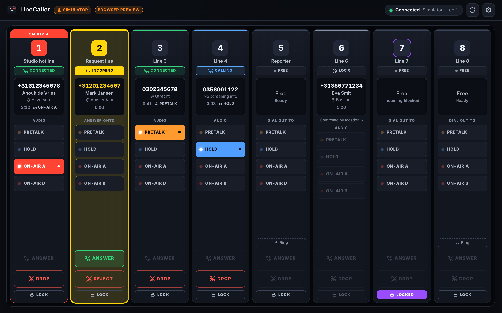
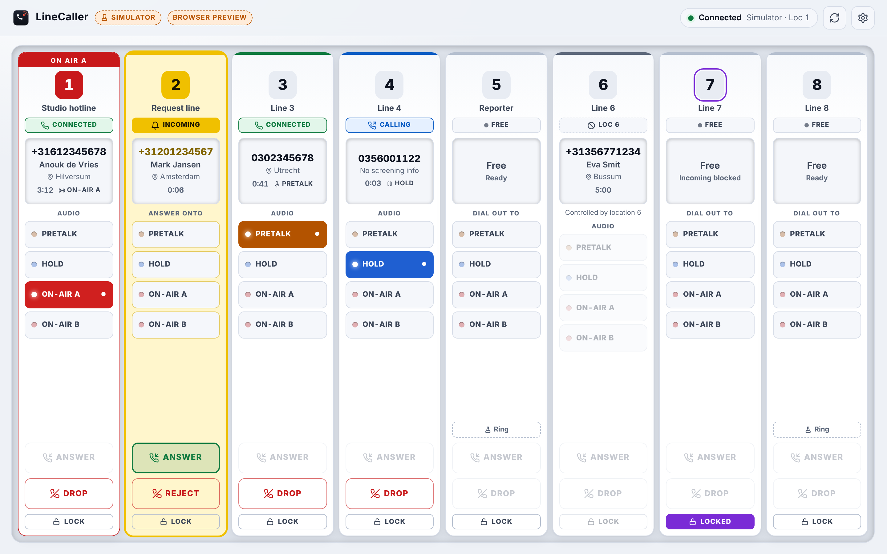
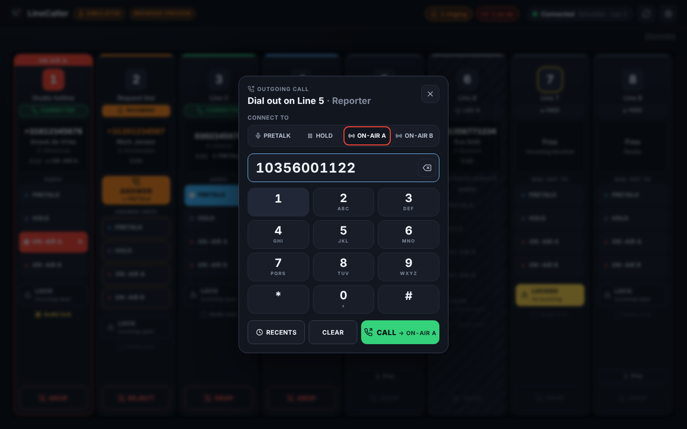
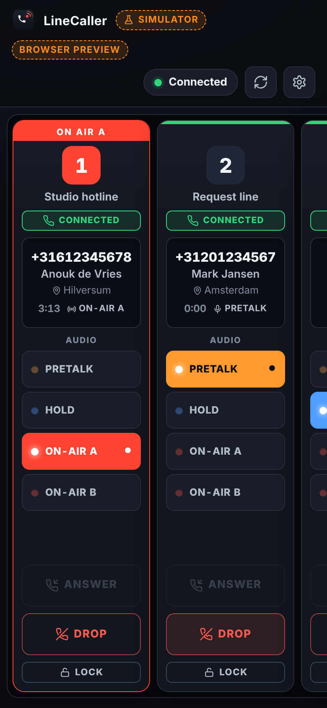

# LineCaller

LineCaller is a desktop app for radio presenters and producers to monitor and control the
telephone lines of a **MAGIC THipPro**. It is an alternative to AVT's THipPro LAN Client, focused
on everyday call handling: see who is ringing, answer to pretalk or air, dial out, move callers
between PRETALK / HOLD / ON-AIR A / ON-AIR B, lock and drop.

It talks to the THipPro over the **AVT Remote Light Protocol** only. It never changes the
THipPro's own configuration.



| Light theme | Dial keypad | Narrow window |
|---|---|---|
|  |  |  |

## Features

* 1 to 16 lines (configurable per installation), each drawn as a vertical **channel strip** side
  by side, like the fader modules of a mixing console: number and state on top, a caller display,
  the destination keys, and at the bottom ANSWER, DROP/REJECT and a half-height LOCK.
* Responsive: strips share the window width; when they no longer fit (many lines, small window,
  phone width) the console scrolls sideways with snap, like scrolling a bank.
* Clear states with text, icon and colour: FREE, INCOMING, CALLING, CONNECTED, RESERVED,
  IN USE (location N), UNKNOWN. An incoming line **blinks yellow, 500 ms on / 500 ms off**, for as
  long as it rings (solid yellow if the OS asks for reduced motion). ON AIR lines get a red tally.
* Caller number, name and city from the THipPro's screening information, with a call timer.
* Per line: PRETALK, HOLD, ON-AIR A, ON-AIR B, ANSWER, DROP, LOCK.
  * **LOCK locks the line for incoming calls** (Remote Light "Set Lock Line"): new calls are
    rejected with busy, outgoing calls still work. Works on a free line too. It turns purple
    while active.
  * Free line: the audio buttons open the dial keypad with that destination preselected.
  * Ringing line: the green-outlined **ANSWER** button right above REJECT answers straight onto
    PRETALK (the destination is a setting, PRETALK by default), or answer onto any destination.
  * Destination colours: PRETALK orange, HOLD blue, ON-AIR A/B red.
  * Busy line: the audio buttons move the call; the keypad never opens.
* Keypad with `*` and `#`, CALL, CLEAR and RECENTS (last 20 numbers dialled from this computer;
  picking one fills the keypad, it never calls by itself).
* **Preferences** in Settings: outline the whole channel strip in the status colour (default), or
  show the status only in the coloured line at the top of the strip.
* Two-step DROP / REJECT (press, then confirm within 4 s; Esc cancels).
* Dark (default), light or system appearance; comfortable or compact density; optional line labels.
* **Import / Export configuration** in Settings: a readable, pretty-printed `.json` file to copy the
  setup from one computer to the next (see below).
* Automatic reconnect with back-off, stale-status marking, protocol warnings shown in the UI.
* **Simulator mode** (on by default): a built-in THipPro stand-in that speaks the real protocol over
  TCP, so the whole app can be tried without placing real calls.

## Project layout

```
crates/rlp/              Remote Light Protocol codec: framing, commands, Line Status (pure, no I/O)
crates/linecaller-core/  TCP connection manager, line store, settings, recents, simulator
  src/bin/rlp-sim.rs     stand-alone simulator for testing
src-tauri/               Tauri 2 shell: commands, events, capabilities, settings storage
src/                     React + TypeScript UI (no protocol code)
  lib/api.ts             the only module that calls the backend
  lib/lineLogic.ts       what each button does in each line state (unit tested)
docs/PROTOCOL_NOTES.md   spec mapping, assumptions, what is and isn't verified
```

The frontend never opens sockets or builds packets. It calls 14 narrowly scoped Tauri commands
and listens to three events (`lc://connection`, `lc://line`, `lc://warning`). The window's
capability (`src-tauri/capabilities/default.json`) allows only those commands plus event
listening: no file system, shell, HTTP or opener access. A strict CSP is set in
`tauri.conf.json`.

## Requirements

| | Windows 10/11 | macOS 11+ |
|---|---|---|
| Rust | stable, via [rustup](https://rustup.rs) (MSVC toolchain) | stable, via rustup |
| Node.js | 20 or newer | 20 or newer |
| Platform tools | [Microsoft C++ Build Tools](https://visualstudio.microsoft.com/visual-cpp-build-tools/) ("Desktop development with C++") and WebView2 (preinstalled on Windows 11) | Xcode Command Line Tools: `xcode-select --install` |

See the [Tauri prerequisites](https://v2.tauri.app/start/prerequisites/) for details.

## Build and run

```bash
npm install          # once
npm run tauri dev    # run the app with hot reload
npm run tauri build  # release build + installers
```

`npm run tauri build` produces:

* **Windows**: `target/release/bundle/msi/LineCaller_0.1.0_x64_en-US.msi` and
  `target/release/bundle/nsis/LineCaller_0.1.0_x64-setup.exe`
* **macOS**: `target/release/bundle/macos/LineCaller.app` and `target/release/bundle/dmg/*.dmg`.
  For a universal (Intel + Apple Silicon) build:
  `rustup target add aarch64-apple-darwin x86_64-apple-darwin` then
  `npm run tauri build -- --target universal-apple-darwin`.

### Troubleshooting the macOS build

**`can't find crate for core` / `can't find crate for std` with "the `x86_64-apple-darwin` target
may not be installed"** during the universal build means the Rust that runs is not rustup's, or
the Intel target was never added. A Rust from conda (a `(base)` prompt) or Homebrew earlier in
`PATH` ignores `rustup target add`. Check and fix it like this:

```bash
which cargo rustc            # both must be in ~/.cargo/bin
rustup target list --installed   # must list aarch64-apple-darwin and x86_64-apple-darwin
conda deactivate             # if the prompt shows (base); or: conda config --set auto_activate_base false
brew uninstall rust          # only if `which rustc` points into Homebrew
rustup target add aarch64-apple-darwin x86_64-apple-darwin
npm run tauri build -- --target universal-apple-darwin
```

If you only need the app for your own Mac, `npm run tauri build` (no `--target`) builds for the
current processor and needs no extra target.

The installers are unsigned. For distribution, add Windows code signing and Apple notarisation as
described in the Tauri docs.

The GitHub Actions workflow in `.github/workflows/ci.yml` runs all tests and builds Windows and
macOS bundles on every push; the installers are attached to the run as artifacts.

## Tests

```bash
cargo test --workspace   # protocol, connection manager, settings, simulator (48 tests)
npm test                 # UI line logic (vitest)
npm run typecheck
```

## Connecting to a THipPro

1. On the THipPro (web configuration) under **PhonerSet / Remote Light**, enable
   **Activate Remote Light Protocol** and note the TCP port for the remote device this LineCaller
   will be (defaults 10100, 10101, … one per device). Assign its PRETALK, ON AIR fader 1/2 and HOLD
   audio under **Remote Light Audio Assignment**. LineCaller does not change these settings.
2. In LineCaller, open **Settings**, turn **Simulator mode** off and enter the THipPro host/IP,
   that port, and the matching **Remote Light location** (1–6).
3. Choose how many lines to show and, optionally, label them.

Settings are stored as JSON in the OS app-config folder
(`%APPDATA%\studio.linecaller.desktop\settings.json` on Windows,
`~/Library/Application Support/studio.linecaller.desktop/settings.json` on macOS), recent numbers in
the app-data folder. Version 0.1.0 used the folder `studio.linecaller.app`; on first start a newer
version copies `settings.json` and `recents.json` from there and leaves the old folder untouched. There are no secrets to protect (the protocol has no authentication); files
are written atomically and are owner-only on macOS.

## Copying the configuration to another computer

In **Settings → Configuration file**:

* **Export configuration…** saves the settings shown in the window to a `.json` file you choose.
* **Import configuration…** loads such a file into the Settings form. Nothing is applied until you
  press **Save settings**, so you can first change what must differ per computer, usually the
  **Remote Light location** (and its port).

The file is plain, indented JSON that can be read and edited by hand:

```json
{
  "format": "linecaller-config",
  "formatVersion": 1,
  "exportedAt": "2026-11-14T06:47:15Z",
  "appVersion": "0.1.0",
  "settings": {
    "host": "192.168.1.50",
    "port": 10100,
    "location": 1,
    "lineCount": 8,
    "theme": "dark",
    "density": "comfortable",
    "lineLabels": ["Studio hotline", "Request line", "", "", "", "", "", "", "", "", "", "", "", "", "", ""],
    "defaultAnswerAudio": "pretalk",
    "autoConnect": true,
    "simulator": false,
    "livenessCheck": true,
    "livenessIntervalSecs": 20
  }
}
```

On import the file is checked: it must say `"format": "linecaller-config"`, settings that are
missing get their defaults, unknown keys are ignored, and invalid values (for example location 7)
are refused with a clear message. Recent numbers are not part of the file. The file dialogs are
opened by the Rust backend, so the window still has no file-system permission.

## Trying it without a THipPro

* **Simulator mode** in Settings (default): LineCaller starts a THipPro simulator on
  `127.0.0.1` and connects to it over TCP. Calls arrive every 15–40 s, Line 6 is "in use by another
  location", numbers starting with `999` are busy. Idle lines show a **Ring** button to trigger a
  call. No real calls are placed.
* **Stand-alone simulator** for testing a release build or another client:
  `cargo run -p linecaller-core --bin rlp-sim -- --bind 127.0.0.1:10100`
  then point LineCaller (simulator mode off) at `127.0.0.1`, port `10100`. Type a line number and
  Enter in the simulator's terminal to make that line ring.
* **Browser preview**: `npm run dev` and open http://localhost:1420 to review the UI with fake data
  (no backend, no protocol).

## Limitations

LineCaller has not yet been tested against a live MAGIC THipPro. The packet layouts and command
semantics were checked against the Remote Light Protocol document and tested against scripted
TCP peers and the simulator. The open points to check on real hardware are listed in
[docs/PROTOCOL_NOTES.md](docs/PROTOCOL_NOTES.md#not-verified-against-a-live-thippro).
